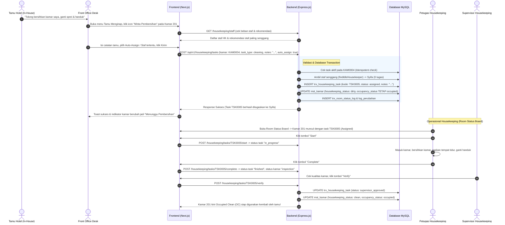

# Rencana Implementasi: Fitur Permintaan Pembersihan Kamar Tamu Menginap (Stayover / Make Up Room Cleaning)

**Tanggal:** 06 Oktober 2026  
**Status:** Menunggu Persetujuan / Siap Dieksekusi  
**Terkait:** Modul Tamu Menginap (`/tamu_menginap`) & Modul Housekeeping (`/housekeeping/room_status_board`)  

---

## 1. Latar Belakang & Analisis Kebutuhan

### 1.1. Skenario Bisnis
Dalam operasional hotel berbintang (*Property Management System* / PMS), saat seorang tamu menginap lebih dari 1 malam (misalnya 2 malam):
1. **Hari ke-1:** Tamu *check-in*, kamar berstatus **Occupied Clean (OC)** (`occupancy_status = 'occupied'`, `housekeeping_status = 'clean'`).
2. **Hari ke-2 (Stayover / In-House):** Kamar memerlukan pembersihan harian (*Make Up Room* / MUR), baik atas permintaan langsung tamu (*On-Demand Guest Request*) maupun jadwal pembersihan rutin pagi hotel.
3. **Kondisi Eksisting Saat Ini:**
   - Tugas pembersihan kamar (`trx_housekeeping_task`) **hanya dibuat secara otomatis saat proses *checkout*** di [checkout_submit.js](file:///d:/COOLYEAGHH/MAGANG%20MARSHTECH/Project/Manajemen_Hotel/manajemen_pms_hotel/express_pms_be/routes/v1/reservasi/checkout/checkout_submit.js) (yang mengubah kamar menjadi `vacant` dan `dirty`).
   - **Belum ada fitur/tombol bagi Front Office di halaman [Tamu Menginap](file:///d:/COOLYEAGHH/MAGANG%20MARSHTECH/Project/Manajemen_Hotel/manajemen_pms_hotel/next_pms_fe/app/(main)/tamu_menginap/page.tsx) untuk meminta pembersihan kamar bagi tamu yang masih menginap.**
   - Di sisi backend, belum ada endpoint mandiri `task_create.js` untuk membuat tugas *housekeeping* baru.
   - Di halaman [Room Status Board](file:///d:/COOLYEAGHH/MAGANG%20MARSHTECH/Project/Manajemen_Hotel/manajemen_pms_hotel/next_pms_fe/app/(main)/housekeeping/room_status_board/page.tsx), tombol "Assign" nonaktif (*disabled*) jika kamar belum memiliki kode *housekeeping task*, sehingga supervisor juga tidak bisa membuat tugas pembersihan secara manual dari papan status kamar.

### 1.2. Prinsip & Standar Best Practice PMS Hotel
Untuk mengimplementasikan fitur ini sesuai *best practice* industri perhotelan dan standar arsitektur repo:
1. **Integritas Status Kamar (Room Status State Machine):**
   - Saat kamar tamu menginap diminta dibersihkan, status okupansi **HARUS TETAP `occupied`** (tidak boleh berubah jadi `vacant` karena tamu masih berhak atas kamar tersebut).
   - Status kebersihan bertransisi:
     $$\text{Clean} \xrightarrow{\text{Request Pembersihan}} \text{Dirty} \xrightarrow{\text{Start Task}} \text{In Progress} \xrightarrow{\text{Complete Task}} \text{Inspection} \xrightarrow{\text{Verify SPV}} \text{Clean (Occupied Clean)}$$
2. **Pencegahan Duplikasi Tugas (Idempotency):**
   - Jika kamar sudah memiliki tugas aktif (`status IN ('assigned', 'in_progress')`), sistem tidak boleh membuat tugas baru yang menumpuk. Front desk harus diberi notifikasi bahwa kamar sedang dalam proses pembersihan.
3. **Otomatisasi Penugasan (Workload-Balanced Auto-Assign):**
   - Front desk dapat memilih untuk **Auto-Assign** ke petugas *housekeeping* yang paling senggang (beban tugas aktif terendah menggunakan [housekeeping_helper.js](file:///d:/COOLYEAGHH/MAGANG%20MARSHTECH/Project/Manajemen_Hotel/manajemen_pms_hotel/express_pms_be/routes/v1/components/tools/housekeeping_helper.js)) atau menunjuk petugas tertentu secara manual.
4. **Catatan Khusus Tamu (Guest Remarks / Special Instructions):**
   - Tamu sering memiliki instruksi spesifik (misal: *"Tolong ganti sprei & handuk"*, *"Bersihkan jam 13:00 saat tamu keluar makan"*, *"Tambah 2 botol air mineral"*). Catatan ini harus tersimpan dan terbaca oleh staf housekeeping.
5. **Audit Trail & Logging:**
   - Setiap perubahan status dicatat ke `trx_room_status_log` dan `log_perubahan` (`ChangesLog`).

---

## 2. Perubahan Skema Database

Akan dibuat skrip migrasi SQL idempoten: `migration_housekeeping_stayover.sql`.

### 2.1. Penambahan Kolom pada `trx_housekeeping_task`
Tabel `trx_housekeeping_task` akan ditambahkan 3 kolom pendukung:
1. `notes` (`TEXT NULL`): Catatan/instruksi khusus dari tamu atau front office.
2. `kode_reservasi_room` (`VARCHAR(50) NULL`): Referensi kamar reservasi tamu yang sedang menginap.
3. `request_source` (`ENUM('front_office', 'guest_request', 'housekeeping', 'checkout') DEFAULT 'guest_request'`): Sumber pemicu tugas pembersihan.

```sql
-- migration_housekeeping_stayover.sql (Idempoten)
SET @col_exists := (SELECT COUNT(*) FROM INFORMATION_SCHEMA.COLUMNS WHERE TABLE_SCHEMA = DATABASE() AND TABLE_NAME = 'trx_housekeeping_task' AND COLUMN_NAME = 'notes');
SET @stmt_sql := IF(@col_exists = 0, 'ALTER TABLE `trx_housekeeping_task` ADD COLUMN `notes` TEXT NULL AFTER `cancel_reason`', 'SELECT 1');
PREPARE exec_stmt FROM @stmt_sql; EXECUTE exec_stmt; DEALLOCATE PREPARE exec_stmt;

SET @col_exists := (SELECT COUNT(*) FROM INFORMATION_SCHEMA.COLUMNS WHERE TABLE_SCHEMA = DATABASE() AND TABLE_NAME = 'trx_housekeeping_task' AND COLUMN_NAME = 'kode_reservasi_room');
SET @stmt_sql := IF(@col_exists = 0, 'ALTER TABLE `trx_housekeeping_task` ADD COLUMN `kode_reservasi_room` VARCHAR(50) NULL AFTER `notes`', 'SELECT 1');
PREPARE exec_stmt FROM @stmt_sql; EXECUTE exec_stmt; DEALLOCATE PREPARE exec_stmt;

SET @col_exists := (SELECT COUNT(*) FROM INFORMATION_SCHEMA.COLUMNS WHERE TABLE_SCHEMA = DATABASE() AND TABLE_NAME = 'trx_housekeeping_task' AND COLUMN_NAME = 'request_source');
SET @stmt_sql := IF(@col_exists = 0, 'ALTER TABLE `trx_housekeeping_task` ADD COLUMN `request_source` ENUM(\'front_office\',\'guest_request\',\'housekeeping\',\'checkout\') NOT NULL DEFAULT \'guest_request\' AFTER `kode_reservasi_room`', 'SELECT 1');
PREPARE exec_stmt FROM @stmt_sql; EXECUTE exec_stmt; DEALLOCATE PREPARE exec_stmt;
```

---

## 3. Rencana Komponen Backend (`express_pms_be`)

### 3.1. Endpoint Baru: Pembuatan Tugas Housekeeping / Request Pembersihan
- **File:** `express_pms_be/routes/v1/housekeeping/task_create.js`
- **Metode & URL:** `POST /api/v1/housekeeping/tasks` (dan alias `POST /api/v1/reservasi/inhouse/housekeeping-request`)
- **Logika Endpoint:**
  1. Validasi payload menggunakan Joi:
     - `kode_kamar`: string wajib (misal `KAM0004`)
     - `kode_cabang`: string wajib / fallback dari session user
     - `task_type`: optional, default `'cleaning'`
     - `priority`: optional (`'normal'` / `'urgent'`), default `'normal'`
     - `notes`: string optional (catatan permintaan tamu)
     - `assigned_to`: number optional (ID user petugas)
     - `auto_assign`: boolean optional (jika true atau `assigned_to` kosong, gunakan `findIdleHousekeeper`)
     - `kode_reservasi_room`: string optional (referensi in-house stay)
     - `request_source`: optional, default `'guest_request'`
  2. Validasi eksistensi kamar pada `mst_kamar` sesuai isolasi cabang (`applyBranchFilter` / `assertBranchScope`).
  3. Cek apakah kamar sudah memiliki tugas aktif (`status IN ('assigned', 'in_progress')`).
     - Jika ada, kembalikan HTTP 400 dengan pesan: *"Kamar [nomor_kamar] sudah memiliki tugas pembersihan aktif ([kode_task]) dengan status [status]"*.
  4. Resolusi petugas PIC:
     - Jika `auto_assign = true` atau `assigned_to` tidak diisi: panggil fungsi `findIdleHousekeeper(kode_cabang, trx)` dari `housekeeping_helper.js`.
     - Jika manual: ambil nama staf dari `mst_user`.
  5. Eksekusi database transaction (`DB.transaction`):
     - Generate nomor sequence task menggunakan `generateSequence("FMT-TASK", trx)`.
     - Insert ke `trx_housekeeping_task`:
       ```javascript
       await trx("trx_housekeeping_task").insert({
         kode_housekeeping_task: taskCode,
         kode_cabang: cabang,
         kode_kamar: kode_kamar,
         task_type: task_type || "cleaning",
         assigned_to: targetUserId,
         priority: priority || "normal",
         status: "assigned",
         notes: notes || null,
         kode_reservasi_room: kode_reservasi_room || null,
         request_source: request_source || "guest_request",
         created_by: user_id,
         created_at: tNow
       });
       ```
     - Update status kamar `mst_kamar`:
       - `housekeeping_status`: diubah menjadi `'dirty'`
       - `occupancy_status`: **tetap dipertahankan** sesuai nilai saat ini (`'occupied'` jika tamu menginap, `'vacant'` jika kamar kosong)
       - `updated_at`: `tNow`, `updated_by`: `user_id`
     - Catat log perubahan status ke `trx_room_status_log` (`generateSequence("FMT-RSL", trx)`).
     - Catat audit trail ke `log_perubahan` melalui `ChangesLog()`.
  6. Kembalikan response sukses `status: "00"` beserta data task yang baru dibuat dan nama petugas yang ditugaskan.

### 3.2. Penyesuaian Endpoint Daftar Tamu Menginap (`inhouse_list.js`)
- **File:** [express_pms_be/routes/v1/reservasi/inhouse/inhouse_list.js](file:///d:/COOLYEAGHH/MAGANG%20MARSHTECH/Project/Manajemen_Hotel/manajemen_pms_hotel/express_pms_be/routes/v1/reservasi/inhouse/inhouse_list.js)
- **Kebutuhan:** Front desk di halaman Tamu Menginap perlu mengetahui status kebersihan kamar secara *real-time* (apakah kamar Bersih, sedang ada tugas, atau sedang dibersihkan).
- **Peningkatan:**
  - Tambahkan join / subquery ke `mst_kamar` dan `trx_housekeeping_task` aktif untuk mengambil:
    - `mk.housekeeping_status`
    - `latest_task.kode_housekeeping_task`
    - `latest_task.status as task_status`
    - `latest_task.priority as task_priority`
    - `latest_task.notes as task_notes`
    - `latest_task_pic.fullname as task_pic_name`
  - Lampirkan informasi ini ke dalam array `rooms` per kamar tamu menginap.

### 3.3. Penyesuaian Endpoint Housekeeping Terkait
1. [express_pms_be/routes/v1/housekeeping/index.js](file:///d:/COOLYEAGHH/MAGANG%20MARSHTECH/Project/Manajemen_Hotel/manajemen_pms_hotel/express_pms_be/routes/v1/housekeeping/index.js):
   - Mendaftarkan router `createTask`:
     ```javascript
     import createTask from "./task_create.js";
     router.use("/tasks", [], createTask);
     ```
2. [express_pms_be/routes/v1/housekeeping/room_status_board.js](file:///d:/COOLYEAGHH/MAGANG%20MARSHTECH/Project/Manajemen_Hotel/manajemen_pms_hotel/express_pms_be/routes/v1/housekeeping/room_status_board.js):
   - Sertakan kolom `t.notes`, `t.priority`, dan `t.request_source` pada query kamar agar muncul di papan status.
3. [express_pms_be/routes/v1/housekeeping/tasks_get.js](file:///d:/COOLYEAGHH/MAGANG%20MARSHTECH/Project/Manajemen_Hotel/manajemen_pms_hotel/express_pms_be/routes/v1/housekeeping/tasks_get.js):
   - Sertakan `t.notes` dan `t.request_source` pada detail task.

---

## 4. Rencana Komponen Frontend (`next_pms_fe`)

### 4.1. Modul Tamu Menginap (`next_pms_fe/app/(main)/tamu_menginap/`)

#### 4.1.1. Komponen Dialog Baru: `dialog_request_housekeeping.tsx`
- **File:** `next_pms_fe/app/(main)/tamu_menginap/components/dialog_request_housekeeping.tsx`
- **Fungsi:** Form modal intuitif untuk meminta pembersihan kamar tamu menginap.
- **Elemen UI:**
  1. **Header Card Informasi Tamu & Kamar:**
     - Nomor Kamar, Nama Tamu, Tipe Kamar, dan Tanggal Menginap (Check-in & Check-out).
     - Badge status kebersihan saat ini (Clean / Dirty / Sedang Dibersihkan).
  2. **Banner Pengecekan Idempotensi:**
     - Jika kamar sudah memiliki tugas aktif (`task_status = 'assigned'` atau `'in_progress'`), form dinonaktifkan dan muncul banner info:  
       *"Kamar ini sedang dalam proses pembersihan (Task: TSK-xxxx, PIC: [Nama Staf], Status: [In Progress])."*
  3. **Pilihan Prioritas:**
     - Dropdown / RadioButton:
       - `Normal` (Pembersihan reguler)
       - `Urgent` (Mendesak / Tamu sedang menunggu di lobi)
  4. **Pilihan Penugasan Petugas (Housekeeper Assignment):**
     - Opsi default: **Auto-Assign (Rekomendasi Staf Paling Senggang)**
     - Opsi manual: Dropdown staf housekeeping aktif (menampilkan beban kerja terkini, misal *"Syifa (0 tugas aktif - Senggang)"*) yang diambil dari endpoint `/housekeeping/staff`.
  5. **Catatan Khusus Tamu (Guest Notes):**
     - InputTextarea untuk mencatat pesan tamu (misal: *"Tamu minta ganti sprei & tambah 2 botol air mineral"*).
  6. **Aksi Tombol:**
     - Batal / Tutup.
     - Simpan: *"Kirim Permintaan Pembersihan"* dengan indikator loading.

#### 4.1.2. Peningkatan Halaman Tamu Menginap (`page.tsx`)
- **File:** [next_pms_fe/app/(main)/tamu_menginap/page.tsx](file:///d:/COOLYEAGHH/MAGANG%20MARSHTECH/Project/Manajemen_Hotel/manajemen_pms_hotel/next_pms_fe/app/(main)/tamu_menginap/page.tsx)
- **Peningkatan:**
  1. Pada kolom **Kamar**: Tampilkan badge status kebersihan kamar (misal: `Clean` berwarna hijau, `Pembersihan Diminta` berwarna oranye, atau `Sedang Dibersihkan` berwarna biru).
  2. Pada kolom **Aksi**: Tambahkan tombol baru:
     - Icon: `pi pi-sparkles`
     - Tooltip: *"Minta Pembersihan Kamar (Housekeeping)"*
     - Severity: `p-button-help` / `p-button-outlined`
     - Event onClick: Membuka `dialog_request_housekeeping` untuk baris kamar yang dipilih.
  3. Mendaftarkan state dialog dan callback refresh data saat permintaan berhasil dibuat.

### 4.2. Modul Housekeeping Room Status Board (`next_pms_fe/app/(main)/housekeeping/room_status_board/`)

#### 4.2.1. Peningkatan Komponen Aksi Tabel (`table.tsx`)
- **File:** [next_pms_fe/app/(main)/housekeeping/room_status_board/components/display/table.tsx](file:///d:/COOLYEAGHH/MAGANG%20MARSHTECH/Project/Manajemen_Hotel/manajemen_pms_hotel/next_pms_fe/app/(main)/housekeeping/room_status_board/components/display/table.tsx)
- **Masalah Saat Ini:** Tombol `Assign` nonaktif jika `!rowData.kode_housekeeping_task`.
- **Solusi Peningkatan:**
  - Jika kamar belum memiliki task aktif (`!rowData.kode_housekeeping_task`), sediakan tombol **"Buat Tugas"** (`pi pi-plus-circle`, severity `warning`).
  - Menampilkan catatan tamu (`notes`) pada kolom tugas terkini atau dialog detail.
  - Menambahkan tombol **"+ Buat Tugas Pembersihan"** pada Toolbar header Room Status Board agar supervisor bisa membuat tugas pembersihan untuk kamar manapun (baik kamar kosong kotor maupun kamar terisi).

#### 4.2.2. Dialog Pembuatan Tugas Housekeeping (`create_task_dialog.tsx` / `action_dialog.tsx`)
- Mendukung mode:
  1. Penugasan tugas yang sudah ada (*Assign existing task*).
  2. Pembuatan tugas baru langsung dari Room Status Board (*Create & Assign new task*).

---

## 5. Alur Kerja Lengkap (End-to-End Workflow)



---

## 6. Tahapan Pelaksanaan & Rencana File yang Dibuat/Diubah

### Fase 1: Database Migration
- [x] Siapkan skrip SQL idempoten: [migration_housekeeping_stayover.sql](file:///d:/COOLYEAGHH/MAGANG%20MARSHTECH/Project/Manajemen_Hotel/manajemen_pms_hotel/migration_housekeeping_stayover.sql) untuk menambahkan kolom `notes`, `kode_reservasi_room`, dan `request_source` pada `trx_housekeeping_task`.
- [x] Eksekusi migrasi ke database MySQL lokal (`hotel_pms`).

### Fase 2: Backend Development (`express_pms_be`)
1. Buat endpoint baru [express_pms_be/routes/v1/housekeeping/task_create.js](file:///d:/COOLYEAGHH/MAGANG%20MARSHTECH/Project/Manajemen_Hotel/manajemen_pms_hotel/express_pms_be/routes/v1/housekeeping/task_create.js) untuk pembuatan tugas pembersihan / request stayover.
2. Daftarkan router pada [express_pms_be/routes/v1/housekeeping/index.js](file:///d:/COOLYEAGHH/MAGANG%20MARSHTECH/Project/Manajemen_Hotel/manajemen_pms_hotel/express_pms_be/routes/v1/housekeeping/index.js).
3. Perbarui [express_pms_be/routes/v1/reservasi/inhouse/inhouse_list.js](file:///d:/COOLYEAGHH/MAGANG%20MARSHTECH/Project/Manajemen_Hotel/manajemen_pms_hotel/express_pms_be/routes/v1/reservasi/inhouse/inhouse_list.js) agar menyertakan status housekeeping dan detail task aktif kamar tamu.
4. Perbarui [express_pms_be/routes/v1/housekeeping/room_status_board.js](file:///d:/COOLYEAGHH/MAGANG%20MARSHTECH/Project/Manajemen_Hotel/manajemen_pms_hotel/express_pms_be/routes/v1/housekeeping/room_status_board.js) dan [tasks_get.js](file:///d:/COOLYEAGHH/MAGANG%20MARSHTECH/Project/Manajemen_Hotel/manajemen_pms_hotel/express_pms_be/routes/v1/housekeeping/tasks_get.js) untuk menyertakan `notes` dan `request_source`.

### Fase 3: Frontend Development (`next_pms_fe`)
1. Buat komponen modal baru: [next_pms_fe/app/(main)/tamu_menginap/components/dialog_request_housekeeping.tsx](file:///d:/COOLYEAGHH/MAGANG%20MARSHTECH/Project/Manajemen_Hotel/manajemen_pms_hotel/next_pms_fe/app/(main)/tamu_menginap/components/dialog_request_housekeeping.tsx).
2. Daftarkan endpoint baru di [next_pms_fe/app/(main)/tamu_menginap/components/endpoints.ts](file:///d:/COOLYEAGHH/MAGANG%20MARSHTECH/Project/Manajemen_Hotel/manajemen_pms_hotel/next_pms_fe/app/(main)/tamu_menginap/components/endpoints.ts).
3. Integrasikan dialog dan tombol aksi "Minta Pembersihan" serta badge status housekeeping di [next_pms_fe/app/(main)/tamu_menginap/page.tsx](file:///d:/COOLYEAGHH/MAGANG%20MARSHTECH/Project/Manajemen_Hotel/manajemen_pms_hotel/next_pms_fe/app/(main)/tamu_menginap/page.tsx).
4. Perbarui [next_pms_fe/app/(main)/housekeeping/room_status_board/components/display/table.tsx](file:///d:/COOLYEAGHH/MAGANG%20MARSHTECH/Project/Manajemen_Hotel/manajemen_pms_hotel/next_pms_fe/app/(main)/housekeeping/room_status_board/components/display/table.tsx) agar menyediakan tombol "Buat Tugas" untuk kamar yang belum memiliki task dan menampilkan `notes`.
5. Perbarui interfaces di [next_pms_fe/app/(main)/housekeeping/room_status_board/components/interfaces.ts](file:///d:/COOLYEAGHH/MAGANG%20MARSHTECH/Project/Manajemen_Hotel/manajemen_pms_hotel/next_pms_fe/app/(main)/housekeeping/room_status_board/components/interfaces.ts).

### Fase 4: Pengujian & Validasi (Quality Assurance)
1. **Uji Kasus Normal (Happy Path):**
   - Tamu in-house di Kamar 201 meminta pembersihan.
   - Front office mengirimkan request via dialog dengan Auto-Assign dan catatan khusus.
   - Verifikasi status kamar berubah jadi `dirty`, okupansi tetap `occupied`.
   - Housekeeper melihat task di Room Status Board, menekan Start -> Complete -> Supervisor Verify.
   - Kamar kembali berstatus `clean` (`occupied`).
2. **Uji Kasus Pencegahan Duplikasi (Idempotency):**
   - Mengklik permintaan pembersihan ulang pada kamar yang task-nya masih berjalan -> sistem menolak dan menampilkan informasi task aktif.
3. **Uji Isolasi Cabang (Multi-Branch):**
   - Penugasan staf hanya menampilkan staf housekeeping dari cabang aktif yang sama.
4. **Verifikasi Build & Linting:**
   - Memastikan tidak ada compile error pada Next.js frontend dan Express.js backend.

---

## 7. Verifikasi dan Persetujuan

Apakah rencana implementasi ini sudah sesuai dengan kebutuhan dan ekspektasi Anda?  
Jika sudah disetujui, saya siap segera mengeksekusi implementasinya langkah demi langkah!
